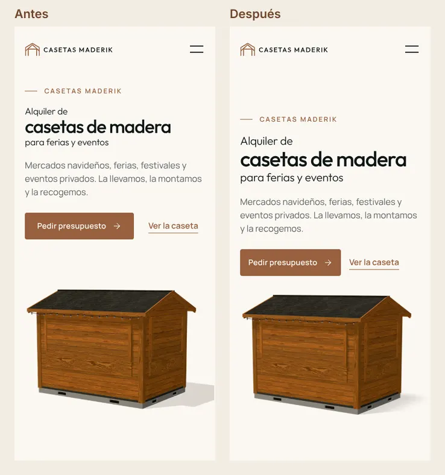
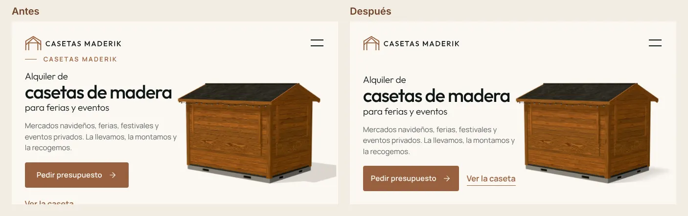
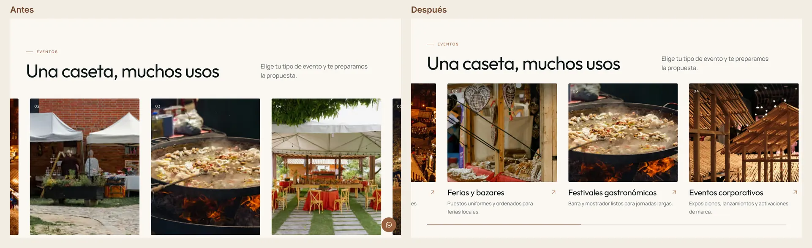
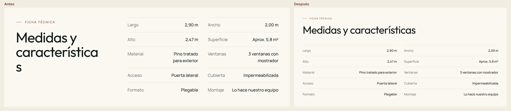
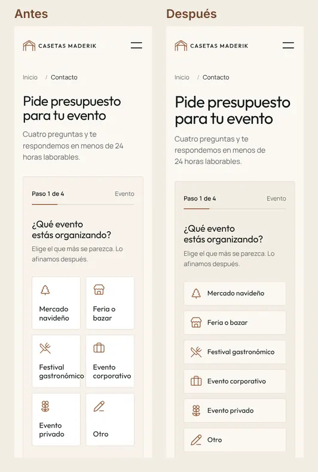
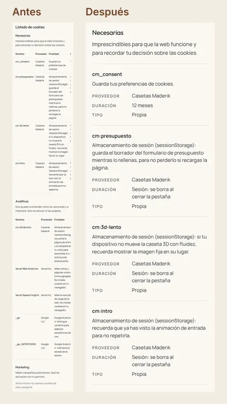
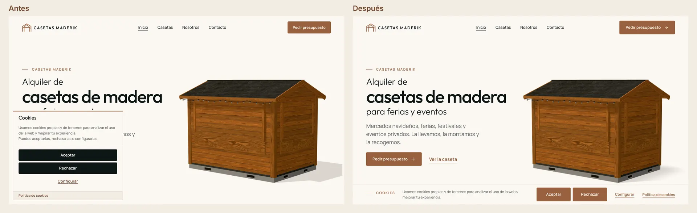
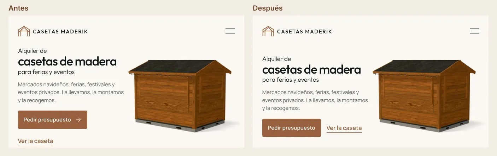
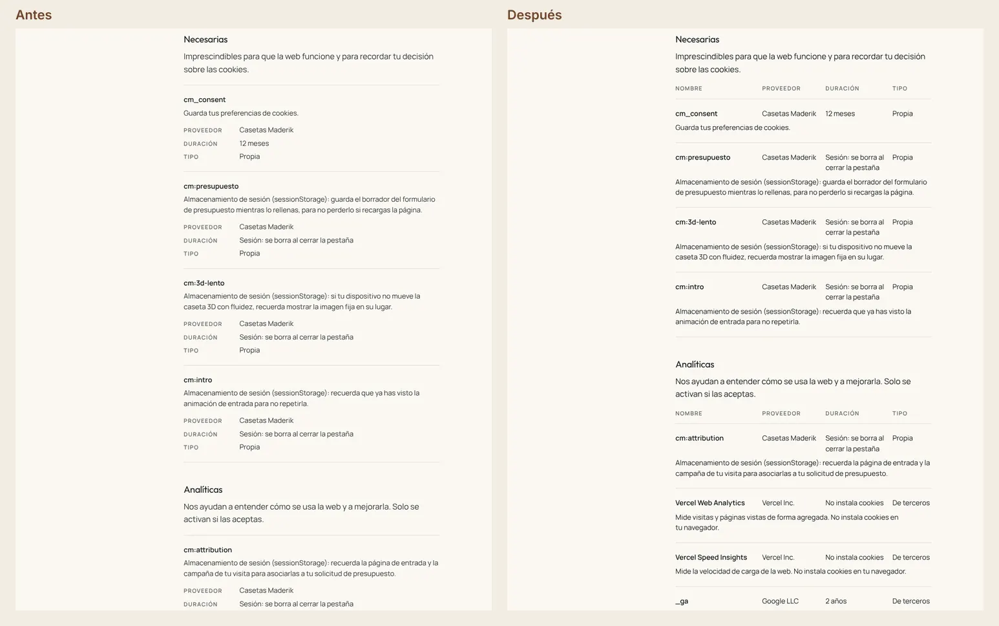

# Informe de QA

Web de Casetas Maderik (Next.js 16). Este informe recoge las pasadas de QA de la sección 20 del brief (el brief pide dos como mínimo; se hicieron tres completas y una verificación final): qué se probó, qué se encontró, qué se corrigió y los resultados finales.

Estado: **QA cerrado**. Las tres pasadas están corregidas y verificadas; lo que solo puede comprobarse tras el despliegue o en dispositivos reales está al final.

## Método

### Automático (`pnpm qa`)

| Comprobación                         | Herramienta                                      | Alcance                                                                                                                                                                                                                                                                |
| ------------------------------------ | ------------------------------------------------ | ---------------------------------------------------------------------------------------------------------------------------------------------------------------------------------------------------------------------------------------------------------------------- |
| Lint, tipos y tests unitarios        | ESLint 9, `tsc`, Vitest                          | Todo el proyecto: validación del formulario, API, Apps Script (simulado con `node:vm`), temporada, SEO, JSON-LD, redirecciones y prohibición de guiones largos y medios                                                                                                |
| End to end                           | Playwright                                       | Formulario (camino feliz, errores en cada paso, "Otro", precarga por URL, volver atrás, doble clic, fallo de red, teclado, borrador), consentimiento, SEO servido, redirecciones, navegación, menú móvil, lightbox, acordeón, 3D, sin JavaScript y movimiento reducido |
| Capturas y comprobaciones por tamaño | Playwright (`tests/qa/screens.spec.ts`)          | 8 rutas × 18 tamaños (320 a 2560 y móviles en horizontal): desbordamiento horizontal con culpables, texto cortado, objetivos táctiles de 44 px, revelados pendientes, consola, peticiones fallidas y CSP                                                               |
| Estados                              | Playwright (`tests/qa/states.spec.ts`)           | Aviso y panel de cookies, header, menú móvil, foco con teclado, acordeón, lightbox, hero de día a noche, footer y formulario (cada paso, errores, éxito y fallo de red)                                                                                                |
| Accesibilidad                        | axe-core                                         | 8 rutas en 1440 y 390, reglas WCAG 2.0, 2.1 y 2.2 A y AA (y en la pasada 3, también las de buenas prácticas y todas las severidades)                                                                                                                                   |
| Contraste sobre fotos                | Playwright y sharp (`tests/qa/contrast.spec.ts`) | Textos que axe no puede resolver (sobre fotos o degradados): se captura el fondo sin las letras y se exige 4,5:1 (3:1 en texto grande) al percentil 5 de los píxeles de cada línea, en las 8 rutas a 1440, 1024, 768 y 390                                             |
| Enlaces                              | `tests/qa/links.mjs`                             | Todos los enlaces internos de todas las páginas                                                                                                                                                                                                                        |
| JavaScript inicial                   | `pnpm size`                                      | Scripts que carga cada página (gzip)                                                                                                                                                                                                                                   |
| Lighthouse                           | Lighthouse CI                                    | 7 URLs, móvil y escritorio, 3 ejecuciones                                                                                                                                                                                                                              |

### Visual

Revisión de **todas** las capturas de cada pasada (144 de páginas y 55 de estados) por revisores independientes, uno por página o grupo de estados. Cada hallazgo pasó después por un verificador que intentaba refutarlo mirando la captura y midiendo en la página real. Solo se corrigió lo confirmado.

En la pasada 3 el método se endureció: un revisor más compara las 8 páginas entre sí (coherencia de títulos, CTA, botones y fondos), cada hallazgo lo juzgan dos verificadores con lentes distintas (la captura y la página real) y un tercero desempata, y otros cuatro agentes comprueban en la página real que las correcciones de la pasada anterior siguen funcionando y no han roto nada alrededor.

### Limitaciones del entorno

- Sin GPU: el WebGL se ejecuta por software (SwiftShader, de 1 a 4 fps). La web detecta el renderizado por software y muestra el poster en lugar del 3D, que es el comportamiento previsto. Las capturas del hero de día a noche y los e2e del 3D fuerzan el 3D con `sessionStorage['cm:3d-forzar'] = '1'`. La fluidez real (50 fps o más) debe comprobarse en dispositivos reales.
- Solo Chromium. WebKit y Firefox están configurados (`PW_ALL_BROWSERS=1`) para ejecutarse en un equipo que los tenga.
- Lighthouse se ejecuta en local, en una máquina de 4 núcleos y sin GPU: las puntuaciones de rendimiento son orientativas y algo peores que en un equipo real o en PageSpeed Insights.

## Pasada 1

### Resultados automáticos

| Comprobación                    | Resultado                                                                                                                                                                                                            |
| ------------------------------- | -------------------------------------------------------------------------------------------------------------------------------------------------------------------------------------------------------------------- |
| Lint y tipos                    | Sin errores ni avisos                                                                                                                                                                                                |
| Tests unitarios                 | 114 de 114                                                                                                                                                                                                           |
| End to end                      | 71 correctos y 2 omitidos (el test de fps se omite sin GPU y uno solo de móvil en el proyecto de escritorio). 1 fallo corregido (botón flotante de WhatsApp, ver abajo)                                              |
| Capturas y comprobaciones (169) | 151 correctas. 18 fallos, todos en Contacto por el mismo motivo: el campo trampa antispam estaba colocado a −10 000 px y se detectaba como elemento fuera de la pantalla. Corregido (`sr-only`) y repetido: 21 de 21 |
| axe                             | 0 incidencias graves o críticas en las 16 combinaciones                                                                                                                                                              |
| Enlaces internos                | 256 comprobados, ninguno roto                                                                                                                                                                                        |
| Consola, red y CSP              | Sin errores, sin peticiones fallidas y sin violaciones de CSP                                                                                                                                                        |

### JavaScript inicial (gzip)

| Página   | Antes de la pasada | Después      |
| -------- | ------------------ | ------------ |
| Inicio   | 158,2 KB           | 158,5 KB     |
| Casetas  | 162,8 KB           | 163,0 KB     |
| Nosotros | 154,1 KB           | 154,1 KB     |
| Contacto | **223,2 KB**       | **155,5 KB** |

Contacto superaba el límite de 170 KB por el formulario (react-hook-form y la librería de animación). Se resolvió renderizando el paso 1 en el servidor con las mismas piezas que el formulario interactivo, que se descarga al quedar libre el navegador o al primer toque, y sustituyendo las animaciones del formulario por CSS (solo opacidad y transformación, 0,6 s).

### Corregido durante la pasada (automático y técnico)

- **3D en equipos sin GPU**: con el renderizado por software la página se bloqueaba (frames de unos 2 s) y el scroll suave no avanzaba. Ahora el 3D no se carga con WebGL por software y, si en un dispositivo real va por debajo de 15 fps tras bajar la calidad, se queda el poster el resto de la sesión (`cm:3d-lento`, documentado en la política de cookies).
- **Revelados al hidratar tarde**: si la página se hidrataba después de que el usuario hubiera bajado (o al recargar a mitad de página), el contenido ya pasado quedaba oculto. Ahora se comprueba también al montar.
- **Contraste de los pasos del montaje**: los pasos inactivos se atenuaban con opacidad y no llegaban a AA; ahora se atenúan con color.
- **Botón flotante de WhatsApp**: con el criterio "tras la primera sección" aparecía demasiado tarde en páginas con una primera sección larga (legales). Ahora aparece tras el hero en Inicio y tras el primer pantallazo en el resto.
- **CSS precargado sin usar** (aviso de consola en Inicio): el CSS de la ilustración de casetas se precargaba al prefetchear enlaces; pasa al CSS global.
- **Imagen Open Graph**: usa el render del 3D a sangre, con el texto a la izquierda.

### Revisión visual

11 revisores, 199 capturas, **100 hallazgos reportados, 85 confirmados** por el verificador (6 graves, 39 medios, 40 leves) y 15 refutados (comportamiento pedido por el brief o artefactos de captura).

Los graves:

1. **Inicio, hero en móvil y en horizontal**: el enlace "Ver la caseta" quedaba encima del tejado de la caseta a 320 px y cortado a 667 × 375, con la etiqueta debajo del header.
2. **Inicio, carril de eventos fijado**: en portátiles (1024 × 768 a 1440 × 810) los títulos y textos de las tarjetas quedaban por debajo del pliegue durante todo el recorrido.
3. **Casetas, H2 partido** a mitad de palabra ("característic / as") entre 1024 y 1280.
4. **Contacto, tarjeta "Festival gastronómico"**: la palabra se salía del borde a 320 px.
5. **Política de cookies en móvil**: las tablas se cortaban y ocultaban las columnas Duración y Tipo.
6. **Aviso de cookies** tapando los CTA del hero en la primera visita (el brief lo prohíbe).

Los medios y leves se agrupan en: footer (rejilla de tablet desalineada, columna Legal estrecha entre 1024 y 1340, footer de una columna en móviles en horizontal), jerarquía H1 menor que los H2 en Casetas y Contacto, sombras cortadas en los posters del 3D, planos a escalas distintas, fotos blandas por `sizes` mal calculados, medida de línea de los textos legales, ritmo del índice legal, enlaces dentro de los textos legales, CTA finales sin botón principal, botón del header fuera de la especificación, menú móvil en horizontal, botón de WhatsApp sobre el acordeón, estados de error del formulario, espacios de no separación en cifras y horarios, y detalles de lightbox, foco y aviso de cookies.

La lista completa con capturas, causa y corrección propuesta de cada hallazgo se generó en la revisión; las correcciones y su verificación se documentan abajo.

## Correcciones de la revisión visual

Los 85 hallazgos confirmados se corrigieron en 8 grupos (hero de Inicio, resto de Inicio, Casetas, Nosotros, Contacto y formulario, legales, footer y global), cada uno en su propia rama y con capturas antes y después. Cada grupo lo revisó después un agente distinto del que lo corrigió, con capturas nuevas y midiendo en la página. Lo que encontró (dos arreglos incompletos en Casetas y Contacto y un ajuste del aviso de cookies) se corrigió en una segunda ronda antes de fusionar (commits "reparación", "regresiones de la revisión" y "QA global (2)").

Los graves, antes y después:

**1 y 2. Hero de Inicio en móvil y en horizontal.** En vertical el hero pasa a columna (texto arriba, caseta debajo, centrados juntos) y "Ver la caseta" ya no pisa el tejado. En horizontal la caseta se encuadra a la derecha y el texto entero cabe junto a ella.

**3. Carril de eventos fijado.** Las tarjetas se dimensionan con la altura disponible: foto, título y texto caben enteros durante todo el recorrido, y la línea de progreso queda a la vista.

**4. H2 partido en Casetas.** Los títulos se componen por frases enteras y la escala de H1 y H2 se revisó para que el H1 sea siempre el mayor.

**5. Tarjetas del formulario a 320 px.** Por debajo de 17,5rem de ancho las tarjetas pasan a filas de una línea, con la marca de selección en el sitio del icono: "Festival gastronómico" cabe siempre entero.

**6. Tablas de la política de cookies en móvil.** Cada cookie pasa a ser una ficha con todas sus columnas; en anchos mayores vuelve a ser una tabla con cabecera única.

**7. Aviso de cookies.** En escritorio es una barra inferior compacta que no tapa el hero. En pantallas bajas espera a que no cubra el H1 ni un CTA, y la página reserva su altura para que el final del contenido nunca quede debajo.

## Pasada 2

Misma batería completa sobre la versión con todas las correcciones de la pasada 1.

### Resultados automáticos

| Comprobación                    | Resultado                                                                                                                                                                                                  |
| ------------------------------- | ---------------------------------------------------------------------------------------------------------------------------------------------------------------------------------------------------------- |
| Lint y tipos                    | Sin errores ni avisos                                                                                                                                                                                      |
| Tests unitarios                 | 118 de 118                                                                                                                                                                                                 |
| End to end                      | 72 correctos y 2 omitidos. Tras las correcciones visuales, 1 fallo en el test del formulario: el nuevo título "Teléfono, WhatsApp o email" coincidía con la etiqueta "Teléfono". Se usan etiquetas exactas |
| Capturas y comprobaciones (170) | 170 de 170                                                                                                                                                                                                 |
| axe                             | 0 incidencias graves o críticas en las 16 combinaciones y con el aviso de cookies abierto                                                                                                                  |
| Enlaces internos                | 256 comprobados, ninguno roto                                                                                                                                                                              |
| Consola, red y CSP              | Sin errores, sin peticiones fallidas y sin violaciones de CSP                                                                                                                                              |

### Revisión visual

11 revisores, 199 capturas (144 de páginas y 55 de estados, recortadas en tramos de pantalla), **42 hallazgos, 30 confirmados** (2 graves, 12 medios y 16 leves) y 12 refutados. Todos los confirmados se corrigieron (commits "Pasada 2 de QA" y "Aviso de cookies: se recoge arriba").

Los graves:

1. **Botones de contorno con foco de teclado**: el relleno aparecía pero el texto no cambiaba de color, así que "Llamar" quedaba como un bloque sin etiqueta (contraste 1:1). Ahora el foco cambia el color igual que el hover.
2. **404 con el aviso de cookies abierto**: a 360 × 778 y 1280 × 720 el aviso tapaba los enlaces de salida. El bloque deja sitio a la banda del aviso.

Los medios:

- **Aviso de cookies al volver arriba**: tras aparecer con el primer scroll, si el usuario volvía arriba tapaba el CTA del hero en móviles bajos. Ahora se recoge mientras se está arriba y cubriría el H1 o un CTA, y vuelve al bajar (salvo que se esté usando con el teclado).
- **Aviso en horizontal sobre el formulario**: la tarjeta del aviso, a la derecha, tapaba "Continuar". Mientras el aviso está pendiente el botón se alinea a la izquierda.
- **Banda reservada del aviso** en horizontal: se veía como una franja crema bajo el footer. Ahora la reserva el footer y es tinta.
- **404 en móviles en horizontal**: el título quedaba cortado por el pliegue y el texto pasaba bajo la tarjeta del aviso. Versión compacta y columna libre.
- **Carril de eventos**: entre 667 y 1024 px no asomaba la siguiente tarjeta (o asomaba una línea de 2 px). Tarjetas algo más estrechas.
- **Foto de la caseta** en Inicio, en horizontal: medía el doble de la pantalla. Se limita a la altura disponible.
- **Foco con teclado en el carril fijado**: la tarjeta enfocada se desalineaba del título. Usa el margen real del contenedor.
- **Botón flotante de WhatsApp** sobre el enlace de WhatsApp del CTA final a 414 y 430 px. El CTA se marca como zona que el botón evita.
- **Isotipo del bloque de marca del footer** (brief 9.3), que se había quitado en la pasada 1: restaurado.
- **Formulario a 320 px**: desde el paso 2 el panel crecía y se comía el margen derecho, y la flecha de "Atrás" se aplastaba. Rejilla de una columna, cifras rápidas en 5 celdas y flechas que no encogen.

Los leves: filete de cierre del CTA oscuro de Casetas antes del footer, galería de Casetas en móvil sin huecos (fotos cuadradas primero), aire del bloque de Eventos fuera del pin, lista de características en una columna entre 1024 y 1279, hero a 667 × 375 con aire entre texto y caseta, H2 de "Cómo trabajamos" por frases a 320, mapa de Nosotros limitado en horizontal, foto del CTA de Contacto nítida en móvil (`sizes`), los tres pasos de Contacto alineados entre 930 y 1179, H2 de canales sin repetir el del CTA final, panel de preferencias a pantalla completa en móvil con el margen del sitio, X del menú alineada con el borde, botones del lightbox con radio de 4 px, espacios de no separación en la microcopia del formulario y botón principal del estado de éxito con flecha.

## Pasada 3

Tercera pasada completa sobre la versión con las correcciones de la pasada 2, más una verificación final de sus propias correcciones.

### Resultados automáticos

| Comprobación                        | Resultado                                                                                                                                                                                                                                                                                                                                              |
| ----------------------------------- | ------------------------------------------------------------------------------------------------------------------------------------------------------------------------------------------------------------------------------------------------------------------------------------------------------------------------------------------------------ |
| Capturas y comprobaciones           | 170 de 170                                                                                                                                                                                                                                                                                                                                             |
| End to end                          | 72 correctos y 2 omitidos (los previstos)                                                                                                                                                                                                                                                                                                              |
| axe con todas las severidades       | 0 incidencias de cualquier severidad, incluidas las de buenas prácticas, en las 16 combinaciones                                                                                                                                                                                                                                                       |
| Contraste medido en píxeles (nuevo) | axe deja "sin determinar" los textos sobre fotos. Medidos píxel a píxel, 7 no llegaban a AA: los números "02" y "03" de las tarjetas del carril (2,8:1), la etiqueta "Temporada navideña" del CTA final en móvil (3,7:1) y "Reservas" y "Planificación" en Nosotros (4,1:1). Corregidos con más velo sobre la foto y convertidos en un test permanente |

### Revisión visual

12 revisores (uno por página o grupo de estados y uno de coherencia entre páginas), 199 capturas más 32 vistas comparadas, **22 hallazgos, 17 confirmados** (2 graves, 6 medios y 9 leves) y 5 refutados. Además, de las 30 correcciones de la pasada 2, 24 seguían bien y 6 habían tenido efectos secundarios; también se corrigieron.

Los graves:

1. **CTA del hero cortado en móviles en horizontal** (regresión de la pasada 2): al estrechar la columna del texto para separarlo de la caseta, "Ver la caseta" bajaba a una segunda fila y el escenario lo cortaba (a 667 × 330 desaparecía). Ahora los dos CTA van en una fila compacta de 600 a 811 px.
2. **Coherencia de los enlaces**: "Ver la caseta" del hero era el único enlace subrayado sin flecha. Ahora lleva flecha como el resto, salvo donde no cabe en una fila.

Los medios: el aviso de cookies tapaba "Escribir por WhatsApp" del CTA final en móviles en horizontal (el texto y las acciones se quedan ahora a la izquierda de la tarjeta), el 404 dejaba la acción pegada al footer y con el aviso abierto asomaba una raya del footer, la tabla de la política de cookies solo aparecía desde 1325 px (vuelve a verse desde 600), la cota "2,90 m" del 3D quedaba tachada por su propia línea, el formulario en escritorio no subía al paso nuevo si Lenis seguía animando la rueda (el paso quedaba encima de la pantalla) y el H2 de la siguiente sección superaba al título del hero en horizontal.

Los leves: aire de 24 px entre el aviso y el H1, ancla de preguntas sin franja de la sección anterior, columnas de la FAQ alineadas con la raya de la etiqueta, intro de la galería en tamaño lead, enlaces subrayados en el panel de preferencias, medida de los títulos legales, texto legal en tinta (no en un gris fuera de la paleta) y palabras sueltas al final de línea en Contacto y en el 404. Los efectos secundarios de la pasada 2 corregidos: el aviso aparecía, se iba y volvía en la primera bajada; títulos del carril en dos líneas a 1024; aire de más en pantallas muy altas; y el botón "Enviar solicitud" cambiaba de fila al pasar a "Enviando" a 320 px, de modo que un segundo toque caía en "Atrás".

### Verificación final

Ocho agentes comprobaron en la página real las 24 correcciones de la pasada 3 (todas funcionan y ninguna ha roto nada) y barrieron 129 capturas nuevas de las zonas tocadas. Confirmaron cuatro detalles más, ya corregidos y medidos: el enlace del hero se partía por dentro de 600 a 611 px, el aviso volvía a aparecer antes de llegar arriba al subir despacio, tres velos de foto no llegaban a AA en tablet (el test de contraste mide ahora a 390, 768, 1024 y 1440) y quedaban palabras de una letra al final de línea en CTA y textos legales. Esto último se resolvió de forma general: titulares, CTA finales, preguntas frecuentes y textos legales unen las palabras de una letra a la siguiente.

### Resultados automáticos finales

Sobre el build final de la entrega (con las mejoras de rendimiento de la sección Lighthouse):

| Comprobación                         | Resultado                                                                                                                                                                                                                                  |
| ------------------------------------ | ------------------------------------------------------------------------------------------------------------------------------------------------------------------------------------------------------------------------------------------ |
| Lint, tipos y formato                | Sin errores ni avisos (ESLint, `tsc`, Prettier)                                                                                                                                                                                            |
| Tests unitarios                      | 121 de 121                                                                                                                                                                                                                                 |
| Capturas, estados, axe y contraste   | 202 de 202 (170 de capturas y estados, 16 de axe y 32 de contraste medido en píxeles a 390, 768, 1024 y 1440)                                                                                                                              |
| End to end                           | 72 correctos y 2 omitidos (el de fps, que necesita GPU, y uno solo de móvil en el proyecto de escritorio). El test de axe del formulario esperaba al fundido de los errores en todos los pasos menos en el 4: se le añadió la misma espera |
| Enlaces internos                     | 275 comprobados, ninguno roto                                                                                                                                                                                                              |
| Consola, red y CSP                   | Sin errores, sin peticiones fallidas y sin violaciones de CSP en ninguna captura                                                                                                                                                           |
| JavaScript inicial (gzip, sin el 3D) | Inicio 160,6 KB · Casetas 164,7 KB · Nosotros 155,3 KB · Contacto 156,6 KB (límite 170 KB)                                                                                                                                                 |

## Rediseño (octubre de 2026)

Cambios pedidos por el cliente tras la primera entrega y cómo se verificaron.

### Qué cambió

- **Fallo de scroll al pasar de claro a oscuro**: la transición entre páginas dejaba un `transform` en el contenedor de la página (animación con `fill: both`). Ese `transform` convertía el contenedor en el bloque de referencia de los elementos fijados y, tras navegar dentro de la web, el carril de Eventos y las secciones fijadas se quedaban en blanco o se cortaban. Ahora la animación no deja nada al terminar. Además, el montaje de /casetas ya no se fija con scroll, y el header cambia de tono en 150 ms cuando el borde entre secciones llega a su pie, sin banda gris a medias.
- **Caseta interactiva** en el hero de Inicio y en el visor de /casetas: se gira y tiene botones de ventanas, puerta (nueva, practicable en el modelo), luces (la sección pasa a noche) y medidas. Sin 3D usa 96 fotogramas pregenerados que también se giran y se abren. Las seis partes de la caseta del visor son botones que la giran hasta cada una y la explican (sustituyen a la lista 01 a 06).
- **Montaje interactivo**: control deslizante plegada ↔ montada, tres pasos y reproducción completa.
- **Sin migas de pan visibles** (se mantiene el JSON-LD) y sin etiquetas encima de los H1 de las páginas interiores. Sin guionado automático.
- **Líneas de tiempo** (Cómo trabajamos, Temporada alta, Qué pasa después): primer punto al inicio, el del medio en el centro exacto y la línea termina en el último.
- **Footer** sin el isotipo encima del nombre en grande.
- **CTA final común**: la misma estructura en todas las páginas (foto a sangre con velo, etiqueta, H2, texto, acciones y nota), con foto y textos propios en cada una. El configurador de /casetas sigue ese orden, con las casetas grandes a la derecha.
- **/casetas**: ficha técnica en tres bandas con fondo propio (veta, degradado cálido y cuadrícula de plano), aviso de medidas aproximadas en un recuadro con icono y galería de cuatro fotos en una fila.
- **/nosotros**: hero estructurado (título arriba, foto contenida), logo en Quiénes somos y mapa de provincias interactivo que lleva al formulario con la provincia elegida.
- **/contacto**: hero, formulario, canales y siguientes pasos rediseñados, con fotos. Admite `?provincia=` y lo muestra en un aviso animado.

### Resultados automáticos

| Prueba                               | Resultado                                                                                                                                                                                                          |
| ------------------------------------ | ------------------------------------------------------------------------------------------------------------------------------------------------------------------------------------------------------------------ |
| Lint, tipos y formato                | Sin errores                                                                                                                                                                                                        |
| Unitarios                            | 125 de 125                                                                                                                                                                                                         |
| End to end                           | 79 correctos y 2 omitidos (el de fps, que necesita GPU, y uno solo de móvil en el proyecto de escritorio). Incluye la caseta interactiva en 3D y con fotogramas, el montaje, el mapa de provincias y `?provincia=` |
| Capturas, estados, axe y contraste   | 202 de 202 (14 anchuras de 320 a 2560 y móvil en horizontal en todas las páginas, axe y contraste medido en píxeles a 390, 768, 1024 y 1440)                                                                       |
| Enlaces internos                     | 416 comprobados, ninguno roto                                                                                                                                                                                      |
| JavaScript inicial (gzip, sin el 3D) | Inicio 164,4 KB · Casetas 169,8 KB · Nosotros 158,3 KB · Contacto 157,6 KB (límite 170 KB)                                                                                                                         |

Corregido durante esta QA: el lienzo 3D (que R3F deja con eventos activos) tapaba la botonera en el hero, la medición de fps pasaba a fotogramas aunque el 3D estuviera forzado en las pruebas, la hoja CSS del mapa de provincias se precargaba en otras páginas sin usarse (ahora va en línea), los botones de las partes de la caseta medían 42 px de alto (ahora 44), el visual ampliado del visor desbordaba en móvil y "WhatsApp" se cortaba a 320 px en el CTA final.

## Lighthouse

`pnpm qa:lighthouse` (Lighthouse CI 12, 3 ejecuciones por URL y modo, servidor de QA en local, throttling simulado por defecto: Moto G Power con 4G lenta y CPU ×4 en móvil, preset de escritorio en escritorio). **Todas las aserciones pasan.** Rendimiento: mediana y, entre paréntesis, las tres ejecuciones.

| Página                 | Móvil           | Escritorio          | Accesibilidad | Buenas prácticas | SEO     |
| ---------------------- | --------------- | ------------------- | ------------- | ---------------- | ------- |
| Inicio                 | 91 (87, 91, 91) | 99 (99, 99, 99)     | 100           | 100              | 100     |
| Casetas                | 87 (85, 87, 93) | 99 (99, 99, 99)     | 100           | 100              | 100     |
| Nosotros               | 91 (91, 91, 93) | 100 (100, 100, 100) | 100           | 100              | 100     |
| Contacto               | 93 (92, 93, 93) | 99 (99, 99, 100)    | 100           | 100              | 100     |
| Aviso legal            | 93 (92, 93, 94) | 100 (100, 100, 100) | 100           | 100              | 66 (\*) |
| Política de privacidad | 93 (93, 93, 94) | 100 (100, 100, 100) | 100           | 100              | 66 (\*) |
| Política de cookies    | 95 (93, 95, 97) | 100 (100, 100, 100) | 100           | 100              | 66 (\*) |

Medición repetida tras el rediseño (octubre de 2026). Casetas en móvil baja de 91 a 87 de mediana, con mucha dispersión entre ejecuciones (85 a 93): ahora el LCP es el primer fotograma de la caseta interactiva, que pinta en la traza real a la vez que el resto, pero la simulación le suma el tiempo de CPU de los scripts de la página, que es la más cargada (visor, montaje, galería y configurador). En escritorio todas las páginas siguen entre 99 y 100.

(\*) Las páginas legales llevan `noindex, follow` por el brief (sección 10.5): Lighthouse descuenta la auditoría de indexabilidad. La configuración comprueba una a una todas las demás auditorías SEO (título, descripción, canonical, enlaces, robots.txt, hreflang, alt) y pasan todas.

Métricas en móvil (mediana): CLS 0 en todas las páginas, TBT de 176 a 297 ms, FCP de 1,2 a 1,4 s simulado. El LCP real (observado en la traza) llega entre 0,22 y 0,32 s, al mismo tiempo que el primer pintado; el simulado da de 2,3 a 3,1 s. La diferencia es de la medición en localhost: con latencia cero, todos los scripts, fuentes e imágenes (unos 350 KB) se piden antes del primer pintado, y la simulación los descarga todos en 4G lenta antes del LCP. Contra el dominio real, con latencia de red, PageSpeed Insights lo medirá con más fidelidad (pendiente tras el despliegue).

### Qué se cambió para llegar ahí

La primera medición de esta pasada dio en móvil entre 59 y 81:

1. **Configuración de Lighthouse**: se lanzaba Chrome con WebGL por software forzado (SwiftShader). Con él, la comprobación de WebGL de la caseta 3D tardaba unos 0,6 s en Inicio y Casetas (×4 en la simulación), algo que no pasa en un dispositivo real ni en PageSpeed Insights, y la web rechaza ese WebGL igualmente y enseña el poster. Ahora usa las opciones por defecto de Chrome, como PageSpeed. Con eso, de 59-81 a 82-91.
2. **Lo que no se ve al cargar espera a la primera interacción** (scroll, rueda, toque, clic, tecla o ratón): GSAP, SplitText, Lenis, el carril fijado (que además ya no descarga GSAP en móvil), la precarga del menú móvil y el formulario interactivo de Contacto. TBT de 214-594 ms a 127-234 ms y rendimiento de 82-91 a 90-95 en una ejecución.
3. **Titulares visibles desde el primer pintado**: antes esperaban a SplitText con opacidad cero (el brief pide no ocultar el H1, que es el LCP). Ahora el H1 entra con un desplazamiento corto en CSS, sin opacidad, y SplitText solo anima los titulares que aún están por debajo de la pantalla.
4. **Imagen LCP de Nosotros** con `loading="eager"` y `fetchPriority="high"`: el `preload` que tenía salía con prioridad baja.

Probado y descartado: el CSS en línea de Next (`experimental.inlineCss`) duplicaba el CSS en la carga de React (HTML de 25 a 99 KB gzip) y empeoraba FCP y LCP.

## Pendiente de validar tras el despliegue

- JSON-LD en Rich Results Test y en validator.schema.org.
- Redirecciones de las URLs antiguas con `curl` en el dominio real (comandos en el README).
- PageSpeed Insights en el dominio real, y los objetivos de campo del brief (LCP por debajo de 2,0 s, INP por debajo de 200 ms, CLS por debajo de 0,05) en Vercel Speed Insights con visitas reales. En local el LCP real es de 0,2 a 0,3 s y el CLS es 0.
- 3D en un iPhone y un Android de gama media.
- Safari y Firefox.
- Apps Script en una cuenta de Google real (`setup()` y solicitud de prueba).
